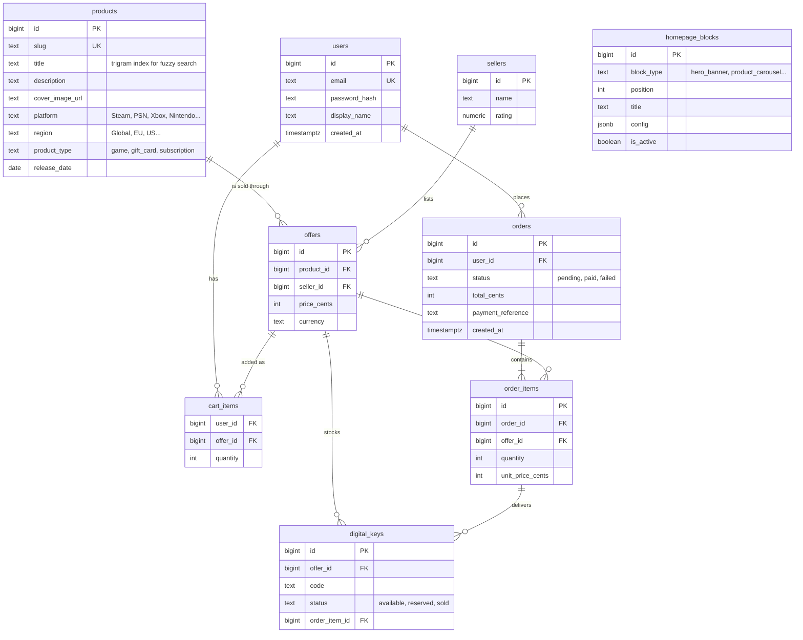

# Eneba Marketplace (Intern Assignment 2027)

A digital-goods marketplace that copies the look and feel of [eneba.com](https://www.eneba.com). Buyers browse a catalog of games, gift cards, and subscriptions. They compare offers from several sellers for the same product, check out with a simulated payment, and receive a digital key.

The project is built in five parts. Each part starts with scoping questions, gets built, and is tested before the next one begins. The goal is a few features done in depth rather than many features done shallowly. The full conversation with the AI assistant is kept in [`chat_history.md`](chat_history.md).

## Status

| Part | Scope | Status |
| --- | --- | --- |
| 1 | Scoping, architecture, setup, "Hello World" checks | Done |
| 2 | Eneba design system and homepage built from backend-driven blocks | Planned |
| 3 | Authentication (sign up, sign in, protected routes) | Planned |
| 4 | Store catalog with filters and sorting, typo-tolerant search | Planned |
| 5 | Product page with seller offers, cart, simulated checkout, key delivery | Planned |

## Tech stack and decisions

| Layer | Choice | Why |
| --- | --- | --- |
| Frontend | React 19 + TypeScript, built with Vite | TypeScript was preferred in the brief. Vite gives fast dev reloads and a static build that deploys to Vercel with no server. |
| Backend | Go 1.27 | Compiles to one static binary, so the Docker image is small and cold starts on free hosting are fast. The standard library HTTP server is production-grade. |
| API style | REST (JSON) | One clear endpoint per feature, easy to test with `curl`, and responses can be cached with normal HTTP rules. GraphQL was considered for the homepage blocks but would add schema and codegen work for little gain at this size. |
| Router | [chi](https://github.com/go-chi/chi) v5 | Thin layer over `net/http`. Route groups make it simple to put checkout and order history behind auth middleware in Part 3. |
| Database | PostgreSQL 17 | Data is relational (products, offers, orders). The `pg_trgm` extension gives typo-tolerant and partial-name search inside the database for Part 4. `JSONB` columns can hold per-block homepage settings. |
| DB driver | [pgx](https://github.com/jackc/pgx) v5 with `pgxpool` | Fast native Postgres driver with connection pooling. |
| Migrations | [goose](https://github.com/pressly/goose) v3, SQL files embedded in the binary | The API applies pending migrations at startup, so a deploy never needs a separate migration step. |
| Hosting (planned) | Vercel (frontend), Render (API in Docker), Neon (Postgres) | All three have free tiers. Neon's free Postgres does not expire, unlike Render's free Postgres (30 days). Render free services sleep after about 15 minutes idle, so the first request after a pause is slow. |

## Architecture

```
                 Development                                      Production (planned)

  Browser ──► Vite dev server :5173                    Browser ──► Vercel (static React build)
                │  serves React app                       │
                │  proxies /api/* ─────┐                  │  fetch(VITE_API_URL + /api/...)
                                       ▼                  ▼
                              Go API :8080          Go API on Render (Docker)
                              chi router                  │
                                       │                  │
                                       ▼                  ▼
                              PostgreSQL 17         Neon PostgreSQL
                              (local service)
```

- **Development:** the Vite dev server proxies every `/api/*` request to the Go API. The browser sees one origin, so CORS does not apply locally.
- **Production:** the frontend calls the API on its own domain through `VITE_API_URL`. The API only allows origins listed in `CORS_ORIGINS`.
- **No hardcoded content:** from Part 2 on, every piece of page content (banners, product lists, prices) comes from the API and the database. The frontend only knows how to render each block type.

## Repository structure

```
eneba-marketplace/
├── README.md                 Architecture, data model, setup (this file)
├── chat_history.md           Full log of the AI-assisted build conversation
├── .gitignore
├── .gitattributes            Forces LF line endings on every platform
├── backend/                  Go REST API
│   ├── cmd/api/main.go       Entry point: config, DB connect, migrate, HTTP server, graceful shutdown
│   ├── internal/
│   │   ├── config/           Reads environment variables (and backend/.env in development)
│   │   ├── db/               Connection pool and migration runner
│   │   │   └── migrations/   Numbered goose SQL migrations, embedded into the binary
│   │   └── httpapi/          Router, middleware, handlers, JSON response helpers
│   ├── .env.example
│   ├── go.mod
│   └── go.sum
└── frontend/                 React + TypeScript single-page app
    ├── src/
    │   ├── api/              Typed fetch client and one module per API resource
    │   ├── App.tsx
    │   ├── main.tsx
    │   └── index.css
    ├── public/
    ├── .env.example
    ├── index.html
    ├── package.json
    └── vite.config.ts        Dev proxy for /api
```

### Backend code layout

- `cmd/api` holds only wiring. It builds dependencies and starts the server.
- `internal/httpapi` holds HTTP concerns: routing, request parsing, status codes, and JSON output. Handlers are methods on an `API` struct that carries shared dependencies such as the DB pool.
- `internal/db` owns the connection and schema migrations.
- As features arrive, each domain gets its own package under `internal/` (for example `catalog`, `auth`, `orders`). Each package holds the SQL queries and business rules for that domain, so handlers stay thin.
- Every error response has the same shape: `{"error": "message"}`.

### Frontend code layout

- `src/api/client.ts` wraps `fetch`. It prefixes `VITE_API_URL`, parses JSON, and throws an `ApiError` with the HTTP status on failure.
- Each API resource gets a small typed module (for example `src/api/health.ts`). Components never call `fetch` directly.
- Pages, components, and the design system arrive in Part 2.

## Data model (draft)

This is the starting plan. Each part's scoping questions may change it, and this section is updated as tables are created. Money is stored as integer cents to avoid floating-point rounding.



Key ideas:

- **One product, many offers.** A product (for example "Elden Ring, Steam, Global") is listed once. Each seller creates an offer with its own price. The product page compares these offers.
- **Stock is real keys.** An offer's stock is the count of its `available` keys. Checkout reserves keys, and payment marks them `sold` and links them to the order item. This makes "key delivery" concrete.
- **Homepage is data.** The homepage is an ordered list of active `homepage_blocks`. Each block's type decides how the frontend renders it, and `config` holds its settings (such as which products a carousel shows).

## API

All endpoints live under `/api` and return JSON.

| Method | Path | Description | Since |
| --- | --- | --- | --- |
| GET | `/api/health` | Returns `{"status":"ok","db":"ok"}`. Returns HTTP 503 with `"db":"down"` if the database is unreachable. | Part 1 |

Unknown paths return HTTP 404 with `{"error":"not found"}`.

### Database outage behavior

Tested in Part 1 by stopping the local PostgreSQL service:

- **Database goes down while the API runs:** `/api/health` returns HTTP 503 with `{"status":"degraded","db":"down"}` within a few milliseconds. The API stays up. The frontend shows "API: degraded · Database: down".
- **Database comes back:** the connection pool reconnects on the next request. No API restart is needed.
- **Database is down when the API starts:** the API logs `connect to database: ...` and exits with code 1. It fails fast instead of serving errors, and the host (Render) restarts it.

## Local development

### Prerequisites

- Go 1.27+
- Node.js 24+ and npm
- PostgreSQL 17 with the `pg_trgm` extension (it ships with standard Postgres installs)

On Windows these can be installed with winget:

```powershell
winget install GoLang.Go
winget install OpenJS.NodeJS.LTS
winget install PostgreSQL.PostgreSQL.17
```

### Database setup (one time)

Create an app role and database. Run this as the `postgres` superuser and pick your own password:

```sql
CREATE ROLE eneba LOGIN PASSWORD 'choose-a-password';
CREATE DATABASE eneba OWNER eneba;
\c eneba
ALTER SCHEMA public OWNER TO eneba;
```

The app does not run as a superuser. `pg_trgm` is a trusted extension, so the database owner can enable it. The first migration does this.

### Run the backend

```bash
cd backend
cp .env.example .env      # then set the password in DATABASE_URL
go run ./cmd/api
```

The API listens on `http://localhost:8080`. It applies any pending migrations at startup.

### Run the frontend

```bash
cd frontend
npm install
npm run dev
```

Open `http://localhost:5173`. The page shows `API: ok · Database: ok` when the whole stack works.

### Checks

```bash
curl http://localhost:8080/api/health    # {"status":"ok","db":"ok"}
cd backend && go vet ./...
cd frontend && npm run build && npm run lint
```

## Configuration

| Variable | Where | Default | Purpose |
| --- | --- | --- | --- |
| `PORT` | backend | `8080` | HTTP port. Render sets this automatically. |
| `DATABASE_URL` | backend | none (required) | Postgres connection string. |
| `CORS_ORIGINS` | backend | `http://localhost:5173` | Comma-separated list of allowed browser origins. |
| `VITE_API_URL` | frontend | empty | API base URL for production builds. Leave empty in development so the Vite proxy is used. |

`.env` files are git-ignored. Only the `.env.example` templates are committed.

## Deployment (planned)

1. **Database:** create a free Neon project and copy its connection string, including `sslmode=require`.
2. **API:** deploy `backend/` to Render as a Docker web service. Set `DATABASE_URL` and `CORS_ORIGINS` (the Vercel URL). Migrations run on boot.
3. **Frontend:** deploy `frontend/` to Vercel. Set `VITE_API_URL` to the Render URL. Add a rewrite of all routes to `index.html` so client-side routing works.

The Dockerfile and hosting config are added in the deployment step.
