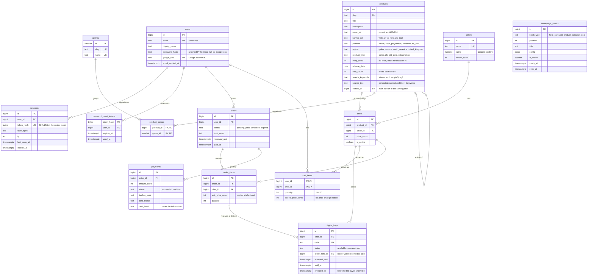

# Eneba Marketplace (Intern Assignment 2027)

A digital-goods marketplace that copies the look and feel of [eneba.com](https://www.eneba.com). Buyers browse a catalog of games, compare offers from several sellers for the same product, check out with a simulated payment, and receive a digital key.

The project is built in five parts. Each part starts with scoping questions, gets built, and is tested before the next one begins. The goal is a few features done in depth rather than many features done shallowly. The full conversation with the AI assistant is kept in [`chat_history.md`](chat_history.md).

**Live demo: https://eneba-marketplace-steel.vercel.app** (payments are simulated; use the test card `4242 4242 4242 4242`). The API sleeps when idle on Render's free plan, so the first request after a pause can take up to a minute.

## Status

| Part | Scope | Status |
| --- | --- | --- |
| 1 | Scoping, architecture, setup, "Hello World" checks | Done |
| 2 | Eneba design system and homepage built from backend-driven blocks | Done |
| 3 | Authentication: email + password, Google sign-in, password reset, account security, protected routes | Done (Google sign-in works locally and on the live site) |
| 4 | Store catalog with filters, facet counts, sorting, and pages; typo-tolerant search with live suggestions | Done |
| 5 | Product page with seller offers and editions, cart, checkout with key reservation, simulated card payment, key delivery | Done |

## Tech stack and decisions

| Layer | Choice | Why |
| --- | --- | --- |
| Frontend | React 19 + TypeScript, built with Vite | TypeScript was preferred in the brief. Vite gives fast dev reloads and a static build that deploys to Vercel with no server. |
| Routing and data | React Router 8, TanStack Query 5 | The router handles pages and links. TanStack Query caches API responses and gives loading, error, and retry states for free. |
| Styling | CSS Modules + design tokens (CSS variables) | Eneba's look needs custom components anyway. Tokens in one file document the design system; CSS Modules keep each component's styles scoped. No runtime cost and no extra dependency. |
| Font | Metropolis via `@fontsource/metropolis` | It is the typeface eneba.com uses, and it is open source, so the real font can be self-hosted. |
| Backend | Go 1.27 | Compiles to one static binary, so the Docker image is small and cold starts on free hosting are fast. The standard library HTTP server is production-grade. |
| API style | REST (JSON) | One clear endpoint per feature, easy to test with `curl`, and cacheable with normal HTTP rules. GraphQL was considered for the homepage blocks but would add schema and codegen work for little gain at this size. |
| Router (API) | [chi](https://github.com/go-chi/chi) v5 | Thin layer over `net/http`. Route groups make it simple to put checkout and order history behind auth middleware in Part 3. |
| Database | PostgreSQL 17 | Data is relational (products, offers, orders). Search runs inside the database: `fuzzystrmatch` (edit distance) finds typos and `pg_trgm` (trigram similarity) ranks results, so no separate search service is needed. `JSONB` holds per-block homepage settings. |
| DB driver | [pgx](https://github.com/jackc/pgx) v5 with `pgxpool` | Fast native Postgres driver with connection pooling. |
| Migrations | [goose](https://github.com/pressly/goose) v3, SQL files embedded in the binary | The API applies pending migrations at startup, so a deploy never needs a separate migration step. |
| Auth | Server-side sessions in an HttpOnly cookie; argon2id passwords; Google via OAuth 2.0 + PKCE (`golang.org/x/oauth2`) | Sessions can be revoked instantly (sign out everywhere, password reset) and JavaScript can never read the token. See [Authentication](#authentication). |
| Images | Steam's public CDN | Real cover art makes the store look real. Images belong to their publishers; this is acceptable for a non-commercial demo only. |
| Tests | `go test` against a real test database; Vitest + Testing Library | Integration tests hit real Postgres so SQL is tested as it runs in production. Frontend tests render real components against a mocked `fetch`. |
| Hosting | Vercel (frontend), Render (API in Docker), Neon (Postgres) | All three have free tiers. Neon's free Postgres does not expire, unlike Render's free Postgres (30 days). Render free services sleep after about 15 minutes idle, so the first request after a pause is slow. |

## Architecture

```
            Development                                  Production          

  Browser ──► Vite dev server :5173              Browser ──► Vercel (static React build)
                 │ proxies /api/*                               │ rewrites /api/*
                 ▼                                              ▼
           Go API :8080 (chi)                     Go API on Render (Docker)
                 │                                              │
                 ▼                                              ▼
           PostgreSQL 17 (local)                      Neon PostgreSQL
```

- **One origin everywhere:** in development the Vite dev server proxies `/api/*` to the Go API; in production a Vercel rewrite does the same. The browser only ever talks to the frontend's origin, so the session cookie is a first-party cookie. This matters because browsers increasingly block third-party cookies, which would break sign-in if the frontend called `*.onrender.com` directly.
- **CORS** is only a fallback for setups that call the API cross-origin through `VITE_API_URL`. The API allows only origins listed in `CORS_ORIGINS`, and the same list drives the CSRF Origin check.
- **No hardcoded content:** every piece of page content (banners, product lists, prices, deal timers) comes from the API and the database. The frontend only knows how to render each block type. Changing, reordering, scheduling, or switching off a homepage block is a database update; no frontend deploy is needed.

## Repository structure

```
eneba-marketplace/
├── README.md                 Architecture, data model, setup (this file)
├── chat_history.md           Full log of the AI-assisted build conversation
├── render.yaml               Render blueprint for the API
├── e2e/                      Browser journeys (Puppeteer), API fuzzing, and a sign-in burst against a running stack
├── backend/                  Go REST API
│   ├── cmd/api/main.go       Entry point: config, DB connect, migrate, wiring, HTTP server, graceful shutdown
│   └── internal/
│       ├── auth/             Passwords, sessions, password reset, Google OAuth, account linking
│       ├── catalog/          Product cards (a product with its cheapest active offer) and Store search
│       ├── config/           Reads environment variables (and backend/.env in development)
│       ├── db/               Connection pool and migration runner
│       │   └── migrations/   Numbered goose SQL migrations, embedded into the binary
│       ├── homepage/         Loads scheduled blocks and turns each block's config into render-ready data
│       ├── orders/           Cart, checkout with key reservation, simulated card payment, order history, key reveal
│       ├── testdb/           Test helper: one migrated schema per test package
│       └── httpapi/          Router, middleware (session loading, auth guard, CSRF), handlers, JSON helpers
└── frontend/                 React + TypeScript single-page app
    └── src/
        ├── api/              Typed fetch client, shared types, one module per API resource
        ├── components/       Shared UI: layout (header with search box, browse row, and user menu; footer), forms, ProductCard, button styles, icons
        ├── features/home/    HomePage, BlockRenderer, blocks/ (HeroCarousel, DealBlock, ProductCarousel), useCountdown
        ├── features/store/   StorePage, FilterPanel, Pagination, URL state (storeParams)
        ├── features/product/ ProductPage: editions, best offer, all seller offers
        ├── features/cart/    CartPage, guest cart in localStorage, CartSync (merge at sign-in), cart hooks
        ├── features/checkout/ CheckoutPage: reservation timer, test card form
        ├── features/auth/    Log in, register, forgot/reset password, route guards, auth hooks
        ├── features/account/ Account layout, security page (profile, password, sessions), order list and order page with keys
        ├── lib/              Price, date, device, and card formatting; enum labels; countdown and debounce hooks
        ├── queryClient.ts    TanStack Query setup, including the global "session ended" (401) handler
        ├── pages/            Status pages: 404 and route error
        ├── styles/           tokens.css (design tokens) and global.css (reset, container, utilities)
        ├── test/             Vitest setup and fixtures
        ├── router.tsx        Route table
        └── main.tsx          Fonts, global styles, query client, router
```

### Backend code layout

- `cmd/api` holds only wiring. It builds dependencies and starts the server.
- `internal/httpapi` holds HTTP concerns: routing, status codes, and JSON output. Handlers are methods on an `API` struct that carries its dependencies.
- Each domain gets its own package under `internal/` with its SQL and business rules: `auth`, `catalog`, `homepage`, and `orders`. Handlers stay thin.
- When a browser abandons a request (for example by navigating away), the database call fails with a cancelled context. That is logged as status 499, not as a server error.
- Input is checked at the HTTP boundary before it reaches SQL: slugs must match the slug format, search text must be valid UTF-8 without NUL bytes (PostgreSQL text can hold neither), and browser-supplied numbers are range-checked.
- Validation errors name the form field: `{"error": "Use at least 8 characters.", "field": "password"}`. The frontend shows the message under that field.
- Every error response has the same shape: `{"error": "message"}`.
- All prices are integer euro cents, to avoid floating-point rounding.

### Frontend code layout

- `src/api/client.ts` wraps `fetch`. It prefixes `VITE_API_URL`, parses JSON, and throws an `ApiError` carrying the HTTP status and body.
- Components never call `fetch` directly. Pages read data through TanStack Query hooks that call the typed functions in `src/api/`.
- Feature code lives in `src/features/<feature>/`. Shared, feature-agnostic UI lives in `src/components/`.

## Design system

The tokens were measured, not guessed. A headless Chrome script loaded eneba.com, walked every visible element, and counted its computed colors, font families, sizes, weights, spacing, and corner radii. It also captured the anatomy of a product card. The most frequent values became the tokens in [`frontend/src/styles/tokens.css`](frontend/src/styles/tokens.css).

| Token | Value | Used for |
| --- | --- | --- |
| `--color-bg` | `#4618ac` | Page background (Eneba purple) |
| `--color-bg-deep` | `#3c1395` | Alternating section bands |
| `--color-surface` | `#1f0a4d` | Card info panels, hero and deal backgrounds, footer |
| `--color-accent` | `#7a4edf` | Loading skeletons, image placeholders |
| `--color-primary` | `#fad318` | Call-to-action buttons, deal label, countdown digits |
| `--color-positive` | `#84e916` | Discounts and offer counts |
| `--color-region` | `#23c299` | Region label on cards |
| `--color-highlight` | `#63e3c2` | Card hover border |
| `--color-text-muted` | `#b3aac9` | Struck-through list prices |
| `--font-sans` | Metropolis 400 / 600 / 700 / 800 | All text; most UI text is 12px at weight 800 |
| Type scale | 10, 12, 14, 15, 16, 19, 22, 30, 40 px | 22px for card prices, 30px for section titles |
| Spacing | 5px grid: 5, 10, 15, 20, 30, 40 px | All gaps and padding |
| Layout | 1200px container, 198px cards with 5:7 covers | Product rows show 5½ cards, hinting that they scroll |
| Corners | Square (`--radius: 0`) | Eneba uses almost no rounding |

Rules:

- Component CSS uses tokens only, never raw colors or sizes.
- Each component has its own CSS Module. `global.css` holds only the reset, `.container`, and `.visually-hidden`.
- Layouts are responsive. Below 768px the search box moves under the logo, the hero drops its side tiles, and cards shrink to 150px. Below 900px the Store's filters move into a full-screen panel opened by a Filters button.
- Motion respects `prefers-reduced-motion`: the hero stops auto-rotating and transitions are switched off.

Deliberate differences from eneba.com: the logo is an original mark (Eneba's logo is a trademark), and cashback is not shown (it is not part of the data model). Eneba's category mega-menu is replaced by a slim browse row (All products plus the main platforms) that links into the Store.

## Homepage blocks

The homepage is an ordered list of rows in `homepage_blocks`. `GET /api/homepage` returns the rows that are active and inside their schedule, ordered by `position`. Each block's `config` is turned into render-ready `data`: product IDs become full product cards with live prices.

| `block_type` | `config` | What the API resolves |
| --- | --- | --- |
| `hero_carousel` | `interval_ms`; `slides[]` with `product_slug`, `title`, `subtitle`, `image_url`, `cta_label`, `cta_href` | A slide linked to a product gets that product's card (price, discount). A missing image, link, or title is filled in from the product's banner, page URL, and name. |
| `product_carousel` | `source`: `best_selling`, `newest`, `discount`, or `manual`; `product_slugs` (manual only); `limit` (default 12, max 24) | The product list, each with its cheapest active offer. `newest` excludes unreleased games. |
| `deal` | `rotation`: `"daily"`; `product_slugs[]` | Today's product is picked by day number (UTC) modulo the list length. `ends_at` is the next UTC midnight, or the block's own `ends_at` if that is sooner. A product with no active offers is skipped in favor of the next one. |

Behavior rules:

- **Scheduling:** a block shows only when `is_active` is true, `starts_at` is empty or past, and `ends_at` is empty or in the future.
- **Fault isolation:** a block with a broken config, an unknown source, or no purchasable products is left out and logged as a warning. The rest of the page still loads.
- **Unknown types:** the frontend renders nothing for a block type it does not know, so the backend can ship a new block type before the frontend does.
- **Clock skew:** the response includes `server_time`. The deal countdown runs on the server clock, so a wrong clock on the visitor's device does not change the timer. When the timer reaches zero, the frontend refetches and the next deal appears.

## Store and search

Scope chosen in Part 4: filters for platform, region, genre, and price; sorting by best selling and price; a search box on every page with live suggestions plus a full results page.

### Store page (`/store`)

- **The URL is the state.** Search text, filters, sort, and page live in the query string: `/store?q=witcher&platform=steam,gog&genre=rpg&max_price=30&sort=price_asc&page=2`. Results can be shared or bookmarked, and the Back button undoes the last filter. Unknown values in a hand-edited URL are dropped instead of breaking the page; prices are euros in the URL and cents in the API.
- **Filters** combine with OR inside a group (Steam *or* GOG) and AND across groups (Steam *and* RPG *and* under €30). Price applies to the product's cheapest active offer, inclusive at both ends.
- **Facet counts** next to every option show how many results that option gives. Each group ignores its own selection, so with Steam selected the Xbox count still shows what adding Xbox would give. Options with 0 results are disabled. The price inputs show the price range of the current results, before the price filter.
- **Sorting:** best match (default while searching), best selling (default otherwise), and price low to high or high to low. Ties fall back to best selling, then product ID, so pages never overlap or skip items.
- **Pages** hold 24 products. Changing a filter returns to page 1 and keeps the scroll position; page links scroll to the top.
- **Empty states:** "Did you mean …?" when the search text matches nothing; "No products match these filters" with a Clear button when filters hide every result; a reset link when the server rejects a hand-edited filter; a retry button on network errors.
- **Header:** a browse row links to All products and the main platforms. Below 900px the filters move into a full-screen panel with a "Show N results" button.

### Search box (every page)

- After 2 characters it shows the top 6 matches (cover, title, platform, region, price) and a "See all N results" row, after a 200 ms pause in typing so each keystroke does not send a request.
- It follows the ARIA combobox pattern: arrow keys move through suggestions, Enter opens the highlighted product (or the full results in the Store when nothing is highlighted), Escape closes the list, and screen readers hear the result count.
- On the Store page the box shows the current search text.

### How matching works

Titles and queries are normalized the same way (`search_normalize` in migration `00007`): lowercase, apostrophes, dots, and commas removed, and any other punctuation turned into a space. So "Baldur's Gate" matches "baldurs gate", "S.T.A.L.K.E.R. 2" matches "stalker 2", and "Spider-Man" matches "spider man".

A product matches when **every word of the query** matches some word of its title:

| Rule | Example |
| --- | --- |
| The query word starts a title word | `witch` → The **Witch**er 3, `silk` → Hollow Knight: **Silk**song |
| One typo, for query words of 4–6 letters | `witcer` → Witcher, `eldn ring` → ELDEN RING, `kniht` → Knight |
| Two typos, for query words of 7+ letters | `cyberpnk` → Cyberpunk, `wichter` → Witcher, `assasins` → Assassin's |
| Query words of 5+ letters may match across spaces | `spiderman` → Spider-Man, `halflife` → Half-Life |
| The whole query with spaces removed may match | `cyber punk` → Cyberpunk |
| Aliases in `search_keywords` | `gta 5` → Grand Theft Auto V, `bg3`, `rdr2`, `fifa` → EA SPORTS FC |

Guards against loose matches: typo matches must keep the first letter (so `wichter` does not match "fighter"), and query words under 4 letters must match the start of a word exactly (so `cod` does not match "god" and `ac` does not match "black"). `mario`, `zelda`, and `frostpunk` correctly return nothing.

**Ranking:** exact title, then title starting with the query, then the query as a phrase inside the title, then typo matches. Ties are broken by trigram similarity (`pg_trgm`), then by sales.

**Did you mean:** when the text matches nothing, even without filters, the API suggests the product matching the most query words (at least half), for example `witcher game` → "The Witcher 3: Wild Hunt" and `red dead redemption 3` → "Red Dead Redemption 2". When the text does match but filters hide the results, no suggestion is made, since the filters are the problem.

**Performance:** the matching runs as one set-based SQL join over title words, about 1 ms for the catalog. A full Store request (results, total, three facet counts, and the price range in one round trip) takes about 4 ms when browsing and 18–20 ms with search text. A first version used a per-row SQL function and took about 21 ms for the match alone. At a much larger catalog, a word index (distinct title words with a trigram index) would replace the scan.

### Left out on purpose

The product-type filter and the newest and biggest-discount sorts were offered in scoping and not chosen. The seed has only games, so a type filter would have nothing to filter.

## Product page, cart, checkout, and keys

Scope chosen in Part 5: editions with a switcher, a pool of keys per offer, a test-card payment form, quantities per item, a 10-minute reservation timer, and keys hidden until revealed. A simulated order email was offered and not chosen.

### Product page (`/product/:slug`)

- **One product, many offers.** A product is one edition of a game (for example Hades, Steam, Global). Every seller with an active offer is listed with their price, rating, review count, and live stock ("In stock", "Only 2 left", "Sold out"). In-stock offers come first, cheapest first; sold-out offers sit at the bottom with a disabled button.
- **Best price** is the cheapest offer that has stock. It gets a buy box with Buy now (add and go to the cart) and Add to cart.
- **Edition switcher.** Editions of the same game (`products.edition_of` points at the main edition) are listed with each edition's lowest price, for example Steam Global €7.79 and Nintendo Europe €8.09.
- **Stock-aware prices everywhere.** Product cards on the homepage and in the Store use the cheapest offer that can actually be bought, so a sold-out offer never shows as the "from" price.

### Cart

- **Guests** keep their cart in `localStorage`, shared live across tabs. The server prices it (`POST /api/cart/quote`) without storing it.
- **At sign-in** (log in, register, or the Google redirect) the guest cart merges into the account's cart: quantities add up, capped at 10 per offer, and the browser copy is cleared.
- **Lines** show the seller, a quantity stepper limited by stock (max 10 keys per offer), the line total, and "Price went up/dropped from €X" when the price changed since the line was added.
- **Checkout is blocked** while a line is sold out, above the remaining stock, or no longer sold; the line says why.

### Checkout and key reservation

1. **Continue to payment** creates a pending order and reserves the keys for 10 minutes. Each order line copies the current price, so later price changes never alter a placed order.
2. Keys are reserved with `SELECT … FOR UPDATE SKIP LOCKED`: concurrent checkouts take different keys instead of waiting on each other, so a key is never sold twice and the last key goes to exactly one buyer. If any line lacks stock, nothing is reserved and the API answers 409 with what is still available.
3. A user has one open checkout: starting a new one closes the previous order and returns its keys. Cart changes and checkouts lock the user's row, so double clicks and several tabs cannot interleave.
4. **Expiry needs no background job.** A key is for sale when it is `available`, or `reserved` with `reserved_until` in the past; a pending order past `reserved_until` reads as expired. The page shows a countdown on the server's clock and explains when it ran out.
5. **Cancel and return to cart** releases the keys at once.

### Simulated payment

- Card form with formatting as you type (4-digit groups, MM/YY) and the same checks as the server: Luhn checksum, expiry not in the past, 3-digit CVC. Mistakes show on the field.
- Only test cards work, as in Stripe's test mode: `4242 4242 4242 4242` and `5555 5555 5555 4444` succeed, `4000 0000 0000 0002` is declined, `4000 0000 0000 9995` has insufficient funds. Any other number is refused, so nobody types a real card into a demo. Only the brand and last 4 digits are stored.
- **A declined card keeps the reservation**, so the buyer can try another card while the timer runs. (Scoping described a decline as returning the keys; keeping them for a retry matched how real checkouts work, and Cancel or the timer still returns them.)
- **No double charge.** Paying an already paid order returns it unchanged, and a unique index allows only one successful payment per order. Payment locks the order and its keys first, so a reservation that expired and was taken by someone else fails cleanly with "reservation expired" instead of overselling.
- On success the keys are marked sold, the bought lines leave the cart, and the buyer lands on the order page.

### Orders and keys

- `/account/orders` lists paid orders and the open checkout; cancelled and expired checkouts are left out because they never took money or delivered keys.
- The order page shows the card used, each item, and one row per key. Keys are masked (`•••••-•••••-•••••`) until **Reveal key** is clicked; the first reveal time is stored and shown, and a Copy button appears. Other users' orders and keys answer 404.

## Authentication

### Sessions

- Signing in creates a row in `sessions` and sets a cookie holding a random 128-bit token. The database stores only the token's SHA-256 hash, so a database leak does not expose live sessions.
- Cookie attributes: `HttpOnly` (JavaScript cannot read it), `SameSite=Lax`, `Path=/`, `Max-Age` 14 days. In production it is also `Secure` and named `__Host-eneba_session`; browsers reject a `__Host-` cookie unless it is Secure and host-only. Local HTTP development uses `COOKIE_SECURE=false`.
- Sessions slide: each active day pushes expiry 14 days ahead. `last_seen_at` is written at most once an hour, so normal browsing does not write to the database on every request.
- A new session is created on every sign-in (no session fixation). Signing out deletes the row, so the cookie stops working at once, even if a copy of it exists elsewhere.

### Passwords

- argon2id with the OWASP minimum parameters (19 MiB, 2 passes, 1 thread), sized for a 512 MB free-tier instance. Hashes are stored in PHC format and carry their own parameters, so the cost can be raised later without breaking old hashes.
- 8 to 128 characters. Emails are trimmed, lowercased, and unique.
- A failed sign-in returns the same message whether or not the email exists. For an unknown email the server still verifies against a dummy hash, so response timing does not reveal registered emails either. (Registration does say "already exists"; that trade-off favours a clear sign-up form.)

### CSRF protection

Two layers: `SameSite=Lax` stops other sites' form posts from carrying the cookie. The API also rejects any state-changing request whose `Origin` header is not in `CORS_ORIGINS`, and it only accepts JSON bodies, which HTML forms cannot send cross-site.

### Password reset (simulated email)

1. `POST /api/auth/password-reset/request` always answers 202, whether or not the account exists.
2. For a real account it stores a hashed one-time token (30-minute expiry; any older token is invalidated) and "sends" the link `APP_BASE_URL/reset-password?token=...`. The email is simulated: the link is written to the API server log.
3. `POST /api/auth/password-reset/confirm` consumes the token in the same statement that checks it, so it cannot be used twice. It then sets the password, signs out every device, and signs the user in.

### Google sign-in

- Authorization-code flow with PKCE (S256) and a random `state`. Both live in a short-lived HttpOnly cookie scoped to `/api/auth/google`, and the callback compares `state` in constant time.
- The code is exchanged server-to-server with the client secret; the profile comes from Google's userinfo endpoint. Accounts with an unverified Google email are refused.
- The `?next=` return path is checked on both server and client: only same-site relative paths are allowed (no `//evil.com`, no absolute URLs), so it cannot be used as an open redirect.
- Account matching: first by Google ID; then by email, which links Google to the existing account; otherwise a new account without a password is created.
- **Pre-registration takeover protection:** sign-up does not verify email ownership, so someone could register `victim@gmail.com` with a password before the victim arrives. When Google links to an account whose email was never verified, that account's password and sessions are removed, leaving only the Google-proven owner. `email_verified_at` is set by Google sign-in or a completed password reset. An already verified account keeps its password when Google is linked.
- The button only appears when `GOOGLE_CLIENT_ID` and `GOOGLE_CLIENT_SECRET` are set (`GET /api/auth/providers`).

### Account security page

`/account` shows the profile and sign-in methods. Users can change their password there; a Google-only account can set a first password. Changing the password signs out all other devices. The page also lists active sessions (device, IP, signed-in date, last activity, "This device"), with sign-out per device and "Sign out all other devices".

### Protected routes

- **API:** `requireUser` middleware returns 401 for the account, cart, checkout, and order endpoints. Pricing a guest's cart (`POST /api/cart/quote`) is public.
- **Frontend:** `RequireAuth` wraps `/account`, `/account/orders`, `/account/orders/:id`, and `/checkout/:id`. Guests are sent to `/login?next=<page>` and come back after signing in. `GuestOnly` sends signed-in users away from the log-in and register pages.
- **Session ended elsewhere:** any 401 from the API clears the cached user, so a device that was signed out remotely is sent to log in on its next request.

### Deliberately left out

Login rate limiting and "remember me" were offered in scoping and not chosen. Without rate limiting, argon2id's cost is the only brake on password guessing; a per-IP and per-email limiter is the first thing to add before a real launch. Email verification at sign-up is also out of scope, since email is simulated; the takeover protection above covers the main risk this leaves.

### Setting up Google sign-in

1. In [Google Cloud Console](https://console.cloud.google.com/), create a project and configure the OAuth consent screen (External; add your Google account as a test user).
2. Create an OAuth client ID of type **Web application**. Add the authorized redirect URI `http://localhost:5173/api/auth/google/callback`, and later the deployed frontend's `/api/auth/google/callback`.
3. Put the client ID and secret in `backend/.env` as `GOOGLE_CLIENT_ID` and `GOOGLE_CLIENT_SECRET`, then restart the API. "Continue with Google" appears on the log-in and register pages.

## Data model

Money is stored as integer euro cents.



Key ideas:

- **One product, many offers.** A product (for example "ELDEN RING, Steam, Global") is listed once. Each seller has at most one offer per product (`UNIQUE (product_id, seller_id)`). Cards show the cheapest offer that can be bought (active, with a key for sale) and the number of such offers.
- **Stock is the keys themselves.** There is no stock counter to drift out of sync: an offer's stock is the count of its keys that are for sale. Constraints keep each key state consistent (an available key has no holder; a sold key has `sold_at`; only sold keys can be revealed), and a partial unique index allows one successful payment per order.
- **Discounts are derived.** The discount is `(msrp - cheapest price) / msrp`, computed on read, so it can never disagree with the prices.
- **Database constraints guard the data.** `CHECK` constraints limit platforms, regions, and block types to known values, keep prices positive, require a valid slug format, and reject a schedule whose start is after its end. Every user must have a password or a Google link, and emails must be lowercase.
- **One product per platform and region,** like Eneba: "Hades (Steam, Global)" and "Hades (Nintendo, Europe)" are separate products with separate offers. Console and launcher editions reuse the game's Steam artwork.
- **Search text is a generated column.** `search_text` is computed by Postgres from the title and `search_keywords`, so it can never go stale when a title changes.
- **Demo seed data lives in migrations** (`00004`, `00005`, `00008`, `00010`), so the deployed demo gets the same catalog: 155 products (140 distinct games across all 8 platforms and 4 regions, 15 of them linked as editions), 15 genres, 6 sellers, 684 offers (1 to 6 per product), and 8,406 fake keys. Offer prices are generated deterministically from hashes, at 30–85% of MSRP. 56 offers are sold out and 69 have only 1–3 keys, so those states can be seen; every product keeps at least one offer in stock. Checks in `00008` and `00010` fail the migration if a product is left without a genre or without stock.

## API

All endpoints live under `/api` and return JSON.

| Method | Path | Description | Since |
| --- | --- | --- | --- |
| GET | `/api/health` | Returns `{"status":"ok","db":"ok"}`, plus `"version"` (the deployed git commit) on Render. Returns HTTP 503 with `"db":"down"` if the database is unreachable. | Part 1 |
| GET | `/api/homepage` | Returns the visible homepage blocks with resolved data (see [Homepage blocks](#homepage-blocks)). | Part 2 |
| GET | `/api/products` | Store search. Query: `q`, `platform`, `region`, `genre` (comma-separated), `min_price_cents`, `max_price_cents`, `sort` (`relevance`, `best_selling`, `price_asc`, `price_desc`), `page`, `page_size` (max 48). Returns `items`, `total`, `page`, `page_size`, the applied `sort`, `facets`, and `did_you_mean` when nothing matches. 400 for unknown values. | Part 4 |
| GET | `/api/search/suggestions?q=` | Top 6 matches for the header search box, with `total` and `did_you_mean`; no facets. | Part 4 |
| GET | `/api/auth/me` | `{"user": {...}}` when signed in, `{"user": null}` for guests (always 200). | Part 3 |
| GET | `/api/auth/providers` | `{"google": true\|false}`: whether Google sign-in is configured. | Part 3 |
| POST | `/api/auth/register` | `{email, password}` → 201 + session cookie. 409 if the email is taken, 400 with `field` on invalid input. | Part 3 |
| POST | `/api/auth/login` | `{email, password}` → 200 + session cookie, or 401 "Incorrect email or password." | Part 3 |
| POST | `/api/auth/logout` | Deletes the session and clears the cookie. 204. | Part 3 |
| POST | `/api/auth/password-reset/request` | `{email}` → always 202. Sends (logs) a reset link if the account exists. | Part 3 |
| POST | `/api/auth/password-reset/confirm` | `{token, password}` → 200 + new session; all other sessions are revoked. 400 for a used or expired token. | Part 3 |
| GET | `/api/auth/google/start?next=` | Redirects to Google with `state` and a PKCE challenge. | Part 3 |
| GET | `/api/auth/google/callback` | Finishes Google sign-in and redirects to `next`, or to `/login?error=...` on failure. | Part 3 |
| POST | `/api/auth/password` (auth) | `{current_password, new_password}` → 204; signs out other devices. | Part 3 |
| GET | `/api/auth/sessions` (auth) | Active sessions, with `current: true` on this device. | Part 3 |
| DELETE | `/api/auth/sessions/{id}` (auth) | Signs out one of your sessions. 404 for other users' sessions. | Part 3 |
| POST | `/api/auth/sessions/revoke-others` (auth) | Signs out every other session. `{"revoked": n}`. | Part 3 |
| GET | `/api/products/{slug}` | Product page: details, genres, `editions` with their lowest prices, and every active offer with seller and `stock`. 404 for an unknown slug. | Part 5 |
| POST | `/api/cart/quote` | `{items: [{offer_id, quantity, added_price_cents}]}` → the guest's cart priced with current prices and stock, without storing it. | Part 5 |
| GET | `/api/cart` (auth) | `{lines, item_count, total_cents}`; each line has current and added price, stock, and `available`. | Part 5 |
| POST | `/api/cart/items` (auth) | `{offer_id, quantity}` → adds to the line. 409 with `problems` past stock, 409 past 10 per offer or 20 lines, 404 for an inactive offer. | Part 5 |
| PUT / DELETE | `/api/cart/items/{offerID}` (auth) | Set a line's quantity (1–10, within stock) or remove it. | Part 5 |
| POST | `/api/cart/merge` (auth) | Merges a guest cart into the account (used right after sign-in). | Part 5 |
| POST | `/api/checkout` (auth) | Cart → pending order with keys reserved for 10 minutes. 201 with the order and `server_time`; 409 `insufficient_stock` with `problems` if anything is short (nothing reserved). | Part 5 |
| GET | `/api/orders` (auth) | Paid orders and the open checkout, newest first. | Part 3, filled in Part 5 |
| GET | `/api/orders/{id}` (auth) | One of your orders with items, the card used, and keys (codes `null` until revealed). 404 for other users' orders. | Part 5 |
| POST | `/api/orders/{id}/pay` (auth) | `{name, number, expiry, cvc}` with a test card. 200 paid (repeat calls are harmless), 402 declined with `code`, 400 with `field` for form mistakes, 409 `reservation_expired` or `order_closed`. | Part 5 |
| POST | `/api/orders/{id}/cancel` (auth) | Cancels an unpaid order and returns its keys. | Part 5 |
| POST | `/api/orders/{id}/keys/{keyID}/reveal` (auth) | Returns the key's code and records the first reveal. | Part 5 |

(auth) = requires a session; returns 401 otherwise. Unknown paths return HTTP 404 with `{"error":"not found"}`.

Example `/api/homepage` response (shortened):

```json
{
  "server_time": "2026-11-11T16:35:56Z",
  "blocks": [
    {
      "id": 2, "type": "deal", "title": "Deal of the day", "position": 20,
      "data": {
        "ends_at": "2026-11-12T00:00:00Z",
        "product": {
          "id": 23, "slug": "it-takes-two", "title": "It Takes Two",
          "cover_url": "https://shared.akamai.steamstatic.com/.../library_600x900.jpg",
          "banner_url": "https://shared.akamai.steamstatic.com/.../library_hero.jpg",
          "platform": "ea_app", "region": "global", "product_type": "game",
          "msrp_cents": 3999, "price_cents": 2319, "discount_percent": 42, "offer_count": 3
        }
      }
    },
    { "id": 3, "type": "product_carousel", "title": "Best sellers", "position": 30, "data": { "products": ["..."] } }
  ]
}
```

Example `/api/products?q=witcer&page_size=1` response (shortened; the typo still finds both editions):

```json
{
  "items": [
    { "id": 4, "slug": "the-witcher-3-wild-hunt", "title": "The Witcher 3: Wild Hunt", "platform": "steam", "region": "global",
      "msrp_cents": 2999, "price_cents": 1709, "discount_percent": 43, "offer_count": 3, "...": "..." }
  ],
  "total": 2, "page": 1, "page_size": 1, "sort": "relevance",
  "facets": {
    "platforms": [{ "value": "steam", "count": 1 }, { "value": "gog", "count": 1 }, { "value": "xbox", "count": 0 }, "..."],
    "regions": [{ "value": "global", "count": 2 }, "..."],
    "genres": [{ "value": "rpg", "label": "RPG", "count": 2 }, { "value": "adventure", "label": "Adventure", "count": 2 }, "..."],
    "price": { "min_cents": 1589, "max_cents": 1709 }
  }
}
```

### Database outage behavior

Tested in Part 1 by stopping the local PostgreSQL service:

- **Database goes down while the API runs:** `/api/health` returns HTTP 503 with `{"status":"degraded","db":"down"}` within a few milliseconds. The API stays up.
- **Database comes back:** the connection pool reconnects on the next request. No API restart is needed.
- **Database is down when the API starts:** the API logs `connect to database: ...` and exits with code 1. It fails fast instead of serving errors, and the host (Render) restarts it.
- **Homepage while the API is unreachable:** the page shows "We couldn't load the homepage" with a "Try again" button that recovers without a reload.

## Local development

### Prerequisites

- Go 1.27+
- Node.js 24+ and npm
- PostgreSQL 17 with the `pg_trgm` and `fuzzystrmatch` extensions (both ship with standard Postgres installs)

On Windows these can be installed with winget:

```powershell
winget install GoLang.Go
winget install OpenJS.NodeJS.LTS
winget install PostgreSQL.PostgreSQL.17
```

### Database setup (one time)

Create an app role, the app database, and a test database. Run this as the `postgres` superuser and pick your own password:

```sql
CREATE ROLE eneba LOGIN PASSWORD 'choose-a-password';
CREATE DATABASE eneba OWNER eneba;
CREATE DATABASE eneba_test OWNER eneba;
\c eneba
ALTER SCHEMA public OWNER TO eneba;
\c eneba_test
ALTER SCHEMA public OWNER TO eneba;
```

The app does not run as a superuser. `pg_trgm` and `fuzzystrmatch` are trusted extensions, so the database owner can enable them; migrations `00001` and `00007` do this. Neon allows both.

### Run the backend

```bash
cd backend
cp .env.example .env      # then set the password in both database URLs
go run ./cmd/api
```

The API listens on `http://localhost:8080`. It applies any pending migrations at startup, including the demo seed data.

### Run the frontend

```bash
cd frontend
npm install
npm run dev
```

Open `http://localhost:5173`.

### Tests and checks

```bash
cd backend
go vet ./...
go test ./...             # integration tests need TEST_DATABASE_URL (read from backend/.env); they are skipped without it
                          # each test package migrates its own schema (test_catalog, test_orders, ...) via internal/testdb,
                          # so packages run in parallel without seeing each other's fixtures
go test ./internal/httpapi -run '^$' -fuzz FuzzParseSearchQuery -fuzztime 60s   # explores one fuzz target; orders
go test ./internal/orders  -run '^$' -fuzz FuzzNormalizeItems  -fuzztime 60s    # also has FuzzCardCheck
go run golang.org/x/vuln/cmd/govulncheck@latest ./...                            # known vulnerabilities

cd frontend
npm test                  # Vitest + Testing Library, run in America/Los_Angeles to catch time-zone bugs
npm run lint
npm run build             # type-checks, then builds
npm run preview           # serves the build on :5173 with the production security headers (from vercel.json)
npm audit                 # also run in e2e/
```

What the tests cover:

- **Backend unit tests:** discount math and the daily deal rotation, including that a non-UTC clock maps to the same UTC day.
- **Backend integration tests** (real Postgres): the seeded page has 6 blocks in position order, every card price equals the cheapest active offer, best sellers are sorted by sales, hero slides are fully resolved, and the deal ends within 24 hours. Inactive, not-yet-started, expired, malformed, and empty blocks are hidden. A deal's countdown respects the block's own end time and skips a missing product.
- **Frontend tests:** skeleton then blocks in API order, unknown block types ignored, card prices and discounts, countdown on the server clock, refetch when the deal expires, error state with a working retry, and hero navigation.
- **Auth backend tests** (real Postgres, real router, cookie jars as separate devices):
  - Register, log in, and log out. Wrong-password and unknown-email errors are identical.
  - Field-level validation, cookie attributes, and cross-site `Origin` and non-JSON requests rejected.
  - Password reset: no email for unknown accounts, single-use and expiring tokens, all devices signed out.
  - Password change signs out other devices; session listing and revoking work, and users cannot revoke each other's sessions.
  - Google sign-in against a fake Google server that enforces PKCE: new, returning, and linked accounts; the pre-registration takeover case; cancelled, forged-state, missing-cookie, and unverified-email failures; and `next` open-redirect attempts.
- **Auth frontend tests** (the real route table on a memory router):
  - A guest is sent to log in and returned to the original page.
  - Server errors appear on the right field or as an alert.
  - Signed-in users are kept off the log-in page, and `next=//evil.test` is refused.
  - Header sign-out works, and the Google button appears only when configured.
  - A 401 from a revoked session sends the user to log in.
  - Session list and per-device sign-out work; mismatched reset passwords are caught locally.
- **Store and search backend tests** (real Postgres, seeded catalog):
  - 16 queries covering typos, swapped letters, partial words, missing punctuation, extra spaces, aliases, and letter case each return the expected product first.
  - `mario`, `zelda`, `cod`, and `frostpunk` return nothing; `wichter` does not match "Street Fighter"; `ac` matches only word starts.
  - "Did you mean" suggests the closest title, stays silent for nonsense, and stays silent when filters (not spelling) hide the results.
  - Combined filters return only matching products, and every facet count equals the total of actually selecting that option. The price range ignores the price filter, and price bounds are inclusive.
  - Best selling matches the homepage ordering; price sorts stay ordered across pages with no overlap; a page past the end is empty with the right total; products without an active offer are never listed.
  - HTTP: parameter parsing (lists, dedupe, trimming) and 400s for every invalid value; both endpoints' response shapes.
- **Store and search frontend tests:**
  - URL → API query, with unknown values dropped and a reversed price range swapped.
  - Checkbox filters restart at page 1; chips and Clear all work; options with 0 results are disabled.
  - Sorting; price validation; pagination links keep filters; "did you mean"; clearing filters that hide everything; a rejected link; retry after a server error.
  - Header search: suggestions are debounced (no request for 1 letter), arrow keys and Enter open a product, Enter alone opens the Store, Escape closes, and "did you mean" appears in the dropdown.
- **Store browser end-to-end** (headless Chrome, real backend, 36 checks): typo suggestions and keyboard selection, search from another page, did you mean, browse links, genre and price filters (counts match facets, scroll position kept), Back undoes a filter, price sort, 7 pages that continue the sort with no overlap, Back between pages, no broken cover images, and the mobile filter panel and suggestions with no horizontal scroll. All 140 Steam app IDs were also checked against Steam's own names for each title.
- **Cart, checkout, and payment backend tests** (real Postgres; every test makes its own product, offers, keys, and users, so the seeded stock is never touched):
  - Cart rules: adding on top of a line, the stock limit, the 10-per-offer limit, unknown and withdrawn offers, setting and removing lines, and price-change data.
  - Guest carts: pricing without storing; merging adds quantities up to the cap, drops unknown offers, and keeps the guest's added price.
  - Checkout reserves keys for 10 minutes; a declined card keeps them reserved; payment sells exactly the reserved keys, empties the cart, and hides codes; paying twice records one payment; later price changes don't alter the order.
  - Not enough stock reserves nothing and creates no order. **Eight buyers racing for one key: exactly one wins.** A new checkout replaces the open one.
  - An expired reservation returns its keys; if someone else buys them, the late payment fails instead of overselling. Cancel returns keys and is idempotent; paid orders can't be cancelled.
  - Revealing a key records the first reveal only; unpaid keys can't be revealed; other users get 404 for orders, keys, and payment. Order history shows paid and open orders only.
  - Card checks: Luhn, real-looking non-test numbers, expiry month edge, CVC, and decline codes. Product detail: editions, offer order, and stock counts. Cards and search list only products that can be bought, including a key whose reservation ran out.
  - HTTP: the whole flow through the real router, with status codes, error shapes, CSRF blocking, and privacy.
- **Cart, checkout, and payment frontend tests:** product page (editions, offer order, sold-out button, stock-limited adding, Buy now), guest cart priced by the server, merge at log in, quantity stepper, price-change notice, blocked checkout, sold-out-during-checkout refresh, client-side card validation, decline then success, revealed key, expired reservation, order list, and card formatting helpers.
- **Regression tests for bugs found in review and by fuzzing** (each failed before its fix):
  - Backend (`httpapi/regressions_test.go`): a script sent malformed input to every endpoint and found 500s. A NUL byte in a product URL or search text, invalid UTF-8 in search text, and a huge browser-supplied "price when added" in a guest cart (overflowing the `int` column) each crashed a handler. They now get a 404/400, or the price is ignored.
  - Frontend (`src/regressions.test.tsx`): release dates showed a day early west of UTC; the card expiry turned "1/30" into "13/0"; a network failure on the order page said "This order does not exist"; a failed cancel was silent; and a shared Store link with an emoji at the 100th character split it in half, which crashed the page with "URI malformed" while building pagination links. Found on the live site: the header cart badge kept the old count until a refetch returned (about 350 ms on real latency); the cached cart now drops the paid lines at once. The fake API can answer slowly to reproduce this.
- **Purchase journey in the browser** (headless Chrome, real backend, 27 checks): search → product → edition switch → guest cart → register → merged cart → checkout → empty form → declined card → paid → hidden keys → reveal (matches the database) → reload → repeated payment request charges nothing → order history → stock went down → expired reservation → cancel → mobile product and cart pages. The run caught a product cover stretched by its height attribute, and two accessibility issues: edition links read as "Europe€8.09", and two offers of the same game in the cart had identical button labels.
- **Browser end-to-end** (headless Chrome, real backend, 20 checks): the full register → second device → sign out others → change password → header sign-out → forgot password → reset link from the server log → reuse refused → old password rejected flow. It also checks the cookie flags as seen by the browser and the mobile layout. This run caught a sign-out redirect race that jsdom tests could not reproduce. (That Part 3 script was run in an earlier session and is not in the repo; the Part 4 and 5 scripts are, in `e2e/`.)
- **Stress tests** (`go test` runs them; `go test -short` skips them):
  - `auth`: 40 password hashes at once must stay within a memory budget. Each argon2id hash holds 19 MiB, and before a cap of 4 concurrent hashes the burst grew the heap by **760 MiB**, enough to crash Render's 512 MB free plan. On the real server, 60 simultaneous sign-ins peaked at **919 MB before the fix and 194 MB after**, taking 1.0 s instead of 0.7 s. The Docker image also sets `GOMEMLIMIT=400MiB`.
  - `httpapi`: 60 buyers register, fill carts, check out, and pay at the same moment for 25 keys (demand: 120), with declines and triple-clicked Pay buttons. Exactly 25 keys are sold, none twice, each paid order has one successful payment and exactly its quantity of keys. One user's double-click storms: 30 add-to-cart clicks against 5 keys add exactly 5; 15 checkout clicks leave one open order; 20 Pay clicks charge once. 32 clients browsing and searching for 3 seconds get no errors (about 800–1,400 requests/s in-process).
- **Continuous integration** (`.github/workflows/deploy-api.yml`): `go vet` and the full Go suite, stress tests included, run on GitHub's Linux runners against a fresh PostgreSQL 17 for every backend change. Its first runs found two problems a long-lived local database hid:
  - The memory test's budget was a guess too tight for another machine's garbage collector; it is now the container's soft limit (400 MiB), which still fails without the cap (760 MiB).
  - Test packages starting together on a fresh database raced on `CREATE EXTENSION IF NOT EXISTS`, which is not concurrency-safe. Reproduced locally by dropping the extensions (2 of 3 runs failed); a transaction-scoped advisory lock in `internal/testdb` fixed it (6 of 6 runs pass).
- **Fuzz tests** (Go native fuzzing; `go test` runs the seed inputs, `-fuzz` explores): search-parameter parsing always returns valid UTF-8 without NUL bytes, at most 100 characters, a page and page size in range, ordered price bounds, known and unique filter values, and a valid sort. The card check accepts only the test cards, with a matching brand and last four digits. Cart normalization keeps at most 20 lines with unique positive offers, quantities 1–10, and a bounded "price when added". About 3.2 million generated inputs found no failures.
- **Migration round trip** (`db/migrate_test.go`): every migration is rolled back to zero and applied again on its own schema; no table may survive the rollback, and the seed counts must match afterwards. It found that two Down migrations dropped `pg_trgm` and `fuzzystrmatch`, which are database-wide and were still used by the other test schemas. Rolling back now leaves extensions in place.
- **Security headers:** a check of the live site found no Content-Security-Policy, no clickjacking protection (`X-Frame-Options`/`frame-ancestors`), no `nosniff`, and no referrer policy. Worse, API responses with account, cart, and order data had no `Cache-Control`, so Vercel's proxy marked them `public`. The API now sends `Cache-Control: no-store` and `X-Content-Type-Options: nosniff` on every response (`httpapi/headers_test.go`), and `vercel.json` sets the page headers (see Deployment). `e2e/headers.mjs` checks the deployed site.
- **Accessibility scan** (`e2e/a11y.mjs`, axe-core, WCAG 2.1 A/AA plus best practices, 10 pages at desktop and mobile sizes, including a cart with a line): it found the Store's product cards (`h3`) directly under the page title (`h1`), which breaks heading navigation for screen-reader users. A visually hidden "Products" heading now labels the results. 0 violations remain.
- **Dependency scans:** `govulncheck` finds no known vulnerabilities in the Go code; `npm audit` finds none in `frontend/` and none in `e2e/` after upgrading `puppeteer-core` 24 → 25. That upgrade silently dropped the `clickCount` click option, which the browser suites caught (a search box no longer cleared by triple-click); they now use `count`.
- **Flaky test that was a real bug:** the header sign-out test began failing 8 times in 10. The router renders navigations in a transition, so the account page was still mounted when the user was cleared, and the route guard redirected to `/login`. Sign-out now navigates with `flushSync`. That option needs the `RouterProvider` from `react-router/dom`, which the app now uses; with the plain `react-router` provider it was silently ignored. A regression test checks the full navigation history.

#### Load test (autocannon, 50 connections × 8 s each, local server, Windows laptop)

| Endpoint | Requests/s | p50 | p99 | Errors |
| --- | ---: | ---: | ---: | ---: |
| `GET /api/products/hades` | 6,855 | 4 ms | 22 ms | 0 |
| `GET /api/search/suggestions?q=hollow kn` | 1,433 | 31 ms | 75 ms | 0 |
| `GET /api/homepage` | 494 | 62 ms | 1,251 ms | 0 |
| `GET /api/products?sort=price_asc&page=3` | 274 | 109 ms | 423 ms | 0 |
| `GET /api/products?q=assasins creed` | 266 | 90 ms | 1,370 ms | 0 |

There were no errors or timeouts in about 75,000 requests. The long p99 on the homepage and on searches with facet counts comes from requests queuing for the small connection pool (`max(4, CPUs)`); caching the homepage would be the next step if it mattered.

#### Browser and API scripts (`e2e/`)

```bash
cd e2e && npm install
npm run shop     # Part 5 purchase journey (27 checks): search → product → guest cart → register → checkout → pay → reveal key
npm run store    # Part 4 store and search (36 checks)
npm run fuzz     # malformed input to every endpoint; must find 0 server errors
npm run burst    # 60 sign-ins at once
npm run a11y     # axe-core accessibility scan; fails on serious or critical violations
npm run headers  # security headers; needs the production headers (npm run preview, or the live site)
```

They drive a running stack: the frontend at `BASE` (default `http://localhost:5173`) and the API at `API` (default `http://localhost:8080`). Run them against `npm run preview` rather than the dev server to test the production build under its Content-Security-Policy: any blocked script, style, image, or request shows up as a console error, which fails the shop and store suites. They read and clean the database at `E2E_DB_URL` (default: `DATABASE_URL` in `backend/.env`) with `psql`; set `PSQL` and `CHROME_PATH` if they are not in the default places. Test accounts are deleted afterwards and their keys returned to stock. To check the live site, set `BASE=https://eneba-marketplace-steel.vercel.app` and `E2E_DB_URL` to the Neon connection string.

## Configuration

| Variable | Where | Default | Purpose |
| --- | --- | --- | --- |
| `PORT` | backend | `8080` | HTTP port. Render sets this automatically. |
| `DATABASE_URL` | backend | none (required) | Postgres connection string. |
| `CORS_ORIGINS` | backend | `http://localhost:5173` | Comma-separated list of allowed browser origins. |
| `TEST_DATABASE_URL` | backend tests | none | Database for integration tests. Tests skip when it is unset. |
| `APP_BASE_URL` | backend | `http://localhost:5173` | Public frontend origin, used in password-reset links and the default Google redirect URL. |
| `COOKIE_SECURE` | backend | `true` | Set `false` only for local HTTP development. `true` adds `Secure` and the `__Host-` cookie prefix. |
| `GOOGLE_CLIENT_ID`, `GOOGLE_CLIENT_SECRET` | backend | empty | Enable "Continue with Google" when both are set. |
| `GOOGLE_REDIRECT_URL` | backend | `APP_BASE_URL/api/auth/google/callback` | Must match the redirect URI registered with Google. |
| `VITE_API_URL` | frontend | empty | Leave empty: the dev proxy and the Vercel rewrite keep the API same-origin. Only set it for a cross-origin API. |

`.env` files are git-ignored. Only the `.env.example` templates are committed.

## Deployment

| Part | Where | Address |
| --- | --- | --- |
| Website | Vercel, project `eneba-marketplace` | https://eneba-marketplace-steel.vercel.app |
| API | Render web service `eneba-api` (Docker, free plan, Frankfurt) | https://eneba-api-ko2p.onrender.com/api/health |
| Database | Neon, PostgreSQL 18, `aws-eu-central-1` (Frankfurt, next to the API) | private |

- **Database:** a free Neon project. The API uses the *direct* connection string, not the pooled one, because migrations take a session-level advisory lock that a transaction pooler would break. Migrations and seed data ran on the first boot.
- **API:** [`render.yaml`](render.yaml) describes the service and [`backend/Dockerfile`](backend/Dockerfile) builds a static Go binary on a distroless, non-root image. Render cannot auto-deploy a repository added by URL, so [`.github/workflows/deploy-api.yml`](.github/workflows/deploy-api.yml) runs `go vet` and the full Go test suite (against a PostgreSQL 17 service container) on every push that touches the backend. Only if they pass does it call the service's deploy hook, stored as the repository secret `RENDER_DEPLOY_HOOK`. Render checks `/api/health`, which reports the live commit as `version`. Environment variables are set in Render, never in the repo: `DATABASE_URL`, `APP_BASE_URL` and `CORS_ORIGINS` (both the Vercel URL), `GOOGLE_CLIENT_ID`, and `GOOGLE_CLIENT_SECRET`. Cookies default to `Secure` with the `__Host-` prefix.
- **Website:** [`frontend/vercel.json`](frontend/vercel.json) proxies `/api/*` to Render, so the browser only talks to the Vercel domain and the session cookie stays first-party, and sends every other path to `index.html` for client-side routing. It also sets the security headers: a Content-Security-Policy that allows scripts, styles, fonts, and requests only from the site itself and images only from the site and Steam's image CDN (no inline scripts, no `eval`, no framing, no plugins, forms only to the site), `X-Frame-Options: DENY`, `nosniff`, `Referrer-Policy: strict-origin-when-cross-origin`, and a `Permissions-Policy` that turns off camera, microphone, geolocation, and payment APIs. Deploy with `cd frontend && npx vercel deploy --prod`.
- **Google sign-in in production:** the OAuth client in Google Cloud Console must list `https://eneba-marketplace-steel.vercel.app/api/auth/google/callback` as an authorized redirect URI. While the consent screen is in "Testing" mode, only listed test users can sign in with Google.
- **Free-tier behavior:** Render's free service sleeps after about 15 minutes idle and takes up to a minute to wake. If the first request times out, the page shows its error state with a Try again button. Neon's free compute also suspends when idle and wakes in about a second.
- **Checked after deploying:** the browser suites ran against the live site: the store suite (36 checks) and the purchase journey (27 checks). The API fuzzers found 0 server errors there. A burst of 40 simultaneous sign-ins sent straight to Render was answered without a crash (queued for about 10 s on the free plan's CPU). A light read load (10 connections) ran at 75–116 requests/s with a p99 around 300 ms and no errors. The purchase run found that the header cart badge lagged about 350 ms behind a payment on real network latency; it is fixed and covered by a regression test. After the security headers were added, both browser suites, the accessibility scan, the header check, and the fuzzers passed again on the live site under the Content-Security-Policy, and Google sign-in still redirected correctly.
