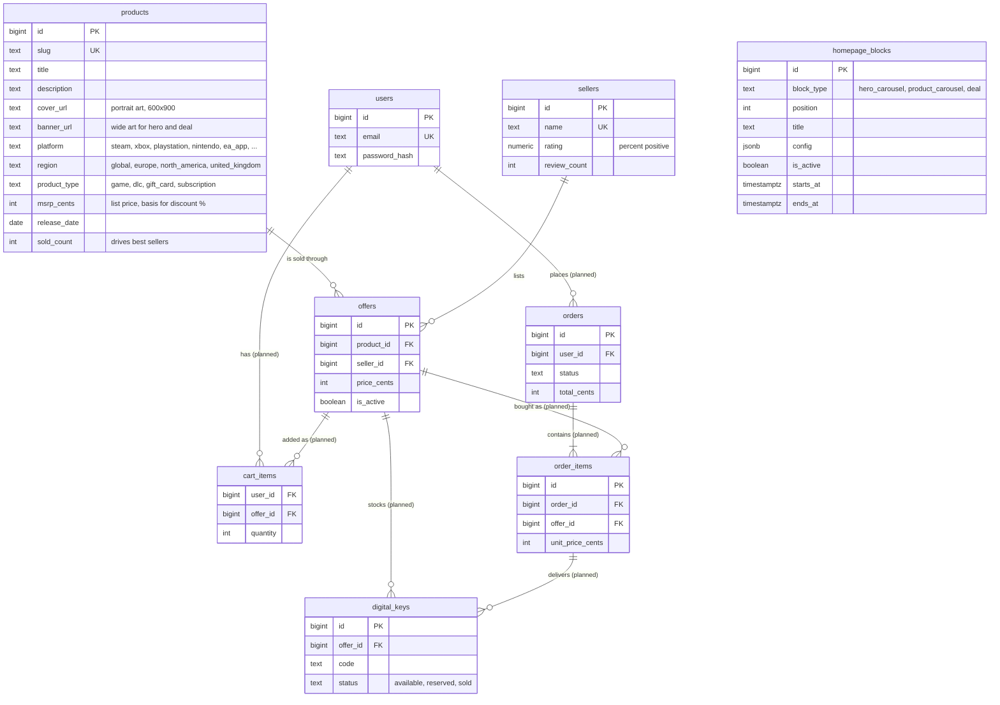

# Eneba Marketplace (Intern Assignment 2027)

A digital-goods marketplace that copies the look and feel of [eneba.com](https://www.eneba.com). Buyers browse a catalog of games, compare offers from several sellers for the same product, check out with a simulated payment, and receive a digital key.

The project is built in five parts. Each part starts with scoping questions, gets built, and is tested before the next one begins. The goal is a few features done in depth rather than many features done shallowly. The full conversation with the AI assistant is kept in [`chat_history.md`](chat_history.md).

## Status

| Part | Scope | Status |
| --- | --- | --- |
| 1 | Scoping, architecture, setup, "Hello World" checks | Done |
| 2 | Eneba design system and homepage built from backend-driven blocks | Done |
| 3 | Authentication (sign up, sign in, protected routes) | Planned |
| 4 | Store catalog with filters and sorting, typo-tolerant search | Planned |
| 5 | Product page with seller offers, cart, simulated checkout, key delivery | Planned |

## Tech stack and decisions

| Layer | Choice | Why |
| --- | --- | --- |
| Frontend | React 19 + TypeScript, built with Vite | TypeScript was preferred in the brief. Vite gives fast dev reloads and a static build that deploys to Vercel with no server. |
| Routing and data | React Router 8, TanStack Query 5 | The router handles pages and links. TanStack Query caches API responses and gives loading, error, and retry states for free. |
| Styling | CSS Modules + design tokens (CSS variables) | Eneba's look needs custom components anyway. Tokens in one file document the design system; CSS Modules keep each component's styles scoped. No runtime cost and no extra dependency. |
| Font | Metropolis via `@fontsource/metropolis` | It is the typeface eneba.com uses, and it is open source, so the real font can be self-hosted. |
| Backend | Go 1.27 | Compiles to one static binary, so the Docker image is small and cold starts on free hosting are fast. The standard library HTTP server is production-grade. |
| API style | REST (JSON) | One clear endpoint per feature, easy to test with `curl`, and cacheable with normal HTTP rules. GraphQL was considered for the homepage blocks but would add schema and codegen work for little gain at this size. |
| Router (API) | [chi](https://github.com/go-chi/chi) v5 | Thin layer over `net/http`. Route groups make it simple to put checkout and order history behind auth middleware in Part 3. |
| Database | PostgreSQL 17 | Data is relational (products, offers, orders). The `pg_trgm` extension gives typo-tolerant and partial-name search inside the database for Part 4. `JSONB` holds per-block homepage settings. |
| DB driver | [pgx](https://github.com/jackc/pgx) v5 with `pgxpool` | Fast native Postgres driver with connection pooling. |
| Migrations | [goose](https://github.com/pressly/goose) v3, SQL files embedded in the binary | The API applies pending migrations at startup, so a deploy never needs a separate migration step. |
| Images | Steam's public CDN | Real cover art makes the store look real. Images belong to their publishers; this is acceptable for a non-commercial demo only. |
| Tests | `go test` against a real test database; Vitest + Testing Library | Integration tests hit real Postgres so SQL is tested as it runs in production. Frontend tests render real components against a mocked `fetch`. |
| Hosting (planned) | Vercel (frontend), Render (API in Docker), Neon (Postgres) | All three have free tiers. Neon's free Postgres does not expire, unlike Render's free Postgres (30 days). Render free services sleep after about 15 minutes idle, so the first request after a pause is slow. |

## Architecture

```
                 Development                                      Production (planned)

  Browser ──► Vite dev server :5173                    Browser ──► Vercel (static React build)
                │  serves React app                       │
                │  proxies /api/* ─────┐                  │  fetch(VITE_API_URL + /api/...)
                                       ▼                  ▼
                              Go API :8080          Go API on Render (Docker)
                              chi router                  │
                                       │                  │
                                       ▼                  ▼
                              PostgreSQL 17         Neon PostgreSQL
                              (local service)
```

- **Development:** the Vite dev server proxies every `/api/*` request to the Go API. The browser sees one origin, so CORS does not apply locally.
- **Production:** the frontend calls the API on its own domain through `VITE_API_URL`. The API only allows origins listed in `CORS_ORIGINS`.
- **No hardcoded content:** every piece of page content (banners, product lists, prices, deal timers) comes from the API and the database. The frontend only knows how to render each block type. Changing, reordering, scheduling, or switching off a homepage block is a database update; no frontend deploy is needed.

## Repository structure

```
eneba-marketplace/
├── README.md                 Architecture, data model, setup (this file)
├── chat_history.md           Full log of the AI-assisted build conversation
├── backend/                  Go REST API
│   ├── cmd/api/main.go       Entry point: config, DB connect, migrate, wiring, HTTP server, graceful shutdown
│   └── internal/
│       ├── catalog/          Product cards: a product joined with its cheapest active offer
│       ├── config/           Reads environment variables (and backend/.env in development)
│       ├── db/               Connection pool and migration runner
│       │   └── migrations/   Numbered goose SQL migrations, embedded into the binary
│       ├── homepage/         Loads scheduled blocks and turns each block's config into render-ready data
│       └── httpapi/          Router, middleware, handlers, JSON response helpers
└── frontend/                 React + TypeScript single-page app
    └── src/
        ├── api/              Typed fetch client, shared types, one module per API resource
        ├── components/       Shared UI: layout (header, footer), ProductCard, button styles, icons
        ├── features/home/    HomePage, BlockRenderer, blocks/ (HeroCarousel, DealBlock, ProductCarousel), useCountdown
        ├── lib/              Price formatting and enum labels
        ├── pages/            Status pages: placeholders for later parts, 404, route error
        ├── styles/           tokens.css (design tokens) and global.css (reset, container, utilities)
        ├── test/             Vitest setup and fixtures
        ├── router.tsx        Route table
        └── main.tsx          Fonts, global styles, query client, router
```

### Backend code layout

- `cmd/api` holds only wiring. It builds dependencies and starts the server.
- `internal/httpapi` holds HTTP concerns: routing, status codes, and JSON output. Handlers are methods on an `API` struct that carries its dependencies.
- Each domain gets its own package under `internal/` with its SQL and business rules: `catalog` and `homepage` so far, `auth` and `orders` later. Handlers stay thin.
- Every error response has the same shape: `{"error": "message"}`.
- All prices are integer euro cents, to avoid floating-point rounding.

### Frontend code layout

- `src/api/client.ts` wraps `fetch`. It prefixes `VITE_API_URL`, parses JSON, and throws an `ApiError` carrying the HTTP status and body.
- Components never call `fetch` directly. Pages read data through TanStack Query hooks that call the typed functions in `src/api/`.
- Feature code lives in `src/features/<feature>/`. Shared, feature-agnostic UI lives in `src/components/`.

## Design system

The tokens were measured, not guessed. A headless Chrome script loaded eneba.com, walked every visible element, and counted its computed colors, font families, sizes, weights, spacing, and corner radii. It also captured the anatomy of a product card. The most frequent values became the tokens in [`frontend/src/styles/tokens.css`](frontend/src/styles/tokens.css).

| Token | Value | Used for |
| --- | --- | --- |
| `--color-bg` | `#4618ac` | Page background (Eneba purple) |
| `--color-bg-deep` | `#3c1395` | Alternating section bands |
| `--color-surface` | `#1f0a4d` | Card info panels, hero and deal backgrounds, footer |
| `--color-accent` | `#7a4edf` | Loading skeletons, image placeholders |
| `--color-primary` | `#fad318` | Call-to-action buttons, deal label, countdown digits |
| `--color-positive` | `#84e916` | Discounts and offer counts |
| `--color-region` | `#23c299` | Region label on cards |
| `--color-highlight` | `#63e3c2` | Card hover border |
| `--color-text-muted` | `#b3aac9` | Struck-through list prices |
| `--font-sans` | Metropolis 400 / 600 / 700 / 800 | All text; most UI text is 12px at weight 800 |
| Type scale | 10, 12, 14, 15, 16, 19, 22, 30, 40 px | 22px for card prices, 30px for section titles |
| Spacing | 5px grid: 5, 10, 15, 20, 30, 40 px | All gaps and padding |
| Layout | 1200px container, 198px cards with 5:7 covers | Product rows show 5½ cards, hinting that they scroll |
| Corners | Square (`--radius: 0`) | Eneba uses almost no rounding |

Rules:

- Component CSS uses tokens only, never raw colors or sizes.
- Each component has its own CSS Module. `global.css` holds only the reset, `.container`, and `.visually-hidden`.
- Layouts are responsive. Below 768px the search box moves under the logo, the hero drops its side tiles, and cards shrink to 150px.
- Motion respects `prefers-reduced-motion`: the hero stops auto-rotating and transitions are switched off.

Deliberate differences from eneba.com: the logo is an original mark (Eneba's logo is a trademark), cashback is not shown (it is not part of the data model), and the category navigation bar was left out during scoping.

## Homepage blocks

The homepage is an ordered list of rows in `homepage_blocks`. `GET /api/homepage` returns the rows that are active and inside their schedule, ordered by `position`. Each block's `config` is turned into render-ready `data`: product IDs become full product cards with live prices.

| `block_type` | `config` | What the API resolves |
| --- | --- | --- |
| `hero_carousel` | `interval_ms`; `slides[]` with `product_slug`, `title`, `subtitle`, `image_url`, `cta_label`, `cta_href` | A slide linked to a product gets that product's card (price, discount). A missing image, link, or title is filled in from the product's banner, page URL, and name. |
| `product_carousel` | `source`: `best_selling`, `newest`, `discount`, or `manual`; `product_slugs` (manual only); `limit` (default 12, max 24) | The product list, each with its cheapest active offer. `newest` excludes unreleased games. |
| `deal` | `rotation`: `"daily"`; `product_slugs[]` | Today's product is picked by day number (UTC) modulo the list length. `ends_at` is the next UTC midnight, or the block's own `ends_at` if that is sooner. A product with no active offers is skipped in favor of the next one. |

Behavior rules:

- **Scheduling:** a block shows only when `is_active` is true, `starts_at` is empty or past, and `ends_at` is empty or in the future.
- **Fault isolation:** a block with a broken config, an unknown source, or no purchasable products is left out and logged as a warning. The rest of the page still loads.
- **Unknown types:** the frontend renders nothing for a block type it does not know, so the backend can ship a new block type before the frontend does.
- **Clock skew:** the response includes `server_time`. The deal countdown runs on the server clock, so a wrong clock on the visitor's device does not change the timer. When the timer reaches zero, the frontend refetches and the next deal appears.

## Data model

Money is stored as integer euro cents. Tables marked *planned* arrive in later parts; each part's scoping questions may still change them.



Key ideas:

- **One product, many offers.** A product (for example "ELDEN RING, Steam, Global") is listed once. Each seller has at most one offer per product (`UNIQUE (product_id, seller_id)`). Cards show the cheapest active offer and the number of offers.
- **Discounts are derived.** The discount is `(msrp - cheapest price) / msrp`, computed on read, so it can never disagree with the prices.
- **Database constraints guard the data.** `CHECK` constraints limit platforms, regions, and block types to known values, keep prices positive, require a valid slug format, and reject a schedule whose start is after its end.
- **Demo seed data lives in migrations** (`00004`, `00005`), so the deployed demo gets the same catalog: 40 games, 6 sellers, and 177 offers (3 to 6 per game). Offer prices are generated deterministically from hashes, at 30–85% of MSRP.

## API

All endpoints live under `/api` and return JSON.

| Method | Path | Description | Since |
| --- | --- | --- | --- |
| GET | `/api/health` | Returns `{"status":"ok","db":"ok"}`. Returns HTTP 503 with `"db":"down"` if the database is unreachable. | Part 1 |
| GET | `/api/homepage` | Returns the visible homepage blocks with resolved data (see [Homepage blocks](#homepage-blocks)). | Part 2 |

Unknown paths return HTTP 404 with `{"error":"not found"}`.

Example `/api/homepage` response (shortened):

```json
{
  "server_time": "2026-11-11T16:35:56Z",
  "blocks": [
    {
      "id": 2, "type": "deal", "title": "Deal of the day", "position": 20,
      "data": {
        "ends_at": "2026-11-12T00:00:00Z",
        "product": {
          "id": 23, "slug": "it-takes-two", "title": "It Takes Two",
          "cover_url": "https://shared.akamai.steamstatic.com/.../library_600x900.jpg",
          "banner_url": "https://shared.akamai.steamstatic.com/.../library_hero.jpg",
          "platform": "ea_app", "region": "global", "product_type": "game",
          "msrp_cents": 3999, "price_cents": 2319, "discount_percent": 42, "offer_count": 3
        }
      }
    },
    { "id": 3, "type": "product_carousel", "title": "Best sellers", "position": 30, "data": { "products": ["..."] } }
  ]
}
```

### Database outage behavior

Tested in Part 1 by stopping the local PostgreSQL service:

- **Database goes down while the API runs:** `/api/health` returns HTTP 503 with `{"status":"degraded","db":"down"}` within a few milliseconds. The API stays up.
- **Database comes back:** the connection pool reconnects on the next request. No API restart is needed.
- **Database is down when the API starts:** the API logs `connect to database: ...` and exits with code 1. It fails fast instead of serving errors, and the host (Render) restarts it.
- **Homepage while the API is unreachable:** the page shows "We couldn't load the homepage" with a "Try again" button that recovers without a reload.

## Local development

### Prerequisites

- Go 1.27+
- Node.js 24+ and npm
- PostgreSQL 17 with the `pg_trgm` extension (it ships with standard Postgres installs)

On Windows these can be installed with winget:

```powershell
winget install GoLang.Go
winget install OpenJS.NodeJS.LTS
winget install PostgreSQL.PostgreSQL.17
```

### Database setup (one time)

Create an app role, the app database, and a test database. Run this as the `postgres` superuser and pick your own password:

```sql
CREATE ROLE eneba LOGIN PASSWORD 'choose-a-password';
CREATE DATABASE eneba OWNER eneba;
CREATE DATABASE eneba_test OWNER eneba;
\c eneba
ALTER SCHEMA public OWNER TO eneba;
\c eneba_test
ALTER SCHEMA public OWNER TO eneba;
```

The app does not run as a superuser. `pg_trgm` is a trusted extension, so the database owner can enable it. The first migration does this.

### Run the backend

```bash
cd backend
cp .env.example .env      # then set the password in both database URLs
go run ./cmd/api
```

The API listens on `http://localhost:8080`. It applies any pending migrations at startup, including the demo seed data.

### Run the frontend

```bash
cd frontend
npm install
npm run dev
```

Open `http://localhost:5173`.

### Tests and checks

```bash
cd backend
go vet ./...
go test ./...             # integration tests need TEST_DATABASE_URL (read from backend/.env); they are skipped without it

cd frontend
npm test                  # Vitest + Testing Library
npm run lint
npm run build             # type-checks, then builds
```

What the tests cover:

- **Backend unit tests:** discount math and the daily deal rotation, including that a non-UTC clock maps to the same UTC day.
- **Backend integration tests** (real Postgres): the seeded page has 6 blocks in position order, every card price equals the cheapest active offer, best sellers are sorted by sales, hero slides are fully resolved, and the deal ends within 24 hours. Inactive, not-yet-started, expired, malformed, and empty blocks are hidden. A deal's countdown respects the block's own end time and skips a missing product.
- **Frontend tests:** skeleton then blocks in API order, unknown block types ignored, card prices and discounts, countdown on the server clock, refetch when the deal expires, error state with a working retry, and hero navigation.

## Configuration

| Variable | Where | Default | Purpose |
| --- | --- | --- | --- |
| `PORT` | backend | `8080` | HTTP port. Render sets this automatically. |
| `DATABASE_URL` | backend | none (required) | Postgres connection string. |
| `CORS_ORIGINS` | backend | `http://localhost:5173` | Comma-separated list of allowed browser origins. |
| `TEST_DATABASE_URL` | backend tests | none | Database for integration tests. Tests skip when it is unset. |
| `VITE_API_URL` | frontend | empty | API base URL for production builds. Leave empty in development so the Vite proxy is used. |

`.env` files are git-ignored. Only the `.env.example` templates are committed.

## Deployment (planned)

1. **Database:** create a free Neon project and copy its connection string, including `sslmode=require`.
2. **API:** deploy `backend/` to Render as a Docker web service. Set `DATABASE_URL` and `CORS_ORIGINS` (the Vercel URL). Migrations and seed data run on boot.
3. **Frontend:** deploy `frontend/` to Vercel. Set `VITE_API_URL` to the Render URL. Add a rewrite of all routes to `index.html` so client-side routing works.

The Dockerfile and hosting config are added in the deployment step.
